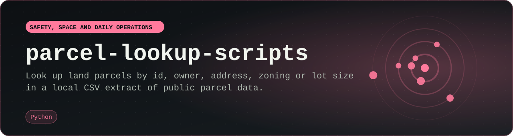
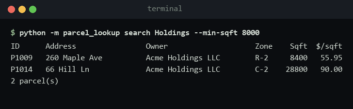

<p align="center"></p>

# parcel-lookup-scripts

[](https://github.com/yassine2med/parcel-lookup-scripts/actions/workflows/ci.yml)  

Look up land parcels by id, owner, address, zoning or lot size in a local CSV extract of public parcel data.



## What it is for

Planners, facility coordinators and project engineers often need to answer quick questions about a piece of land: who owns it, how big it is, how it is zoned and what it is assessed at. Public parcel data is usually a large spreadsheet export that is slow to filter by hand. This tool loads that CSV and answers those questions in one command, with no network calls and no database. It is useful when scoping a site, checking which lots in a zone are large enough for a project, or preparing a short list for a site visit.

## Install

```
git clone <this repo> && cd parcel-lookup-scripts
python -m pip install -r requirements.txt
set PYTHONPATH=src   (Windows)  or  export PYTHONPATH=src
```

Python 3.10 or newer. The tool uses only the standard library; `requirements.txt` lists pytest for the tests.

## How to use

| I want to | Command |
|---|---|
| Show one parcel | `python -m parcel_lookup id P1002` |
| Search owner or address text | `python -m parcel_lookup search Trust` |
| Filter by zoning district | `python -m parcel_lookup search --zoning I-1` |
| Filter by minimum lot size (sqft) | `python -m parcel_lookup search --min-sqft 30000` |
| Combine filters | `python -m parcel_lookup search Acme --zoning R-1 --min-sqft 5000` |
| Totals per zoning district | `python -m parcel_lookup summary` |
| Use another CSV file | `python -m parcel_lookup --data my.csv summary` |

Worked example:

```
$ python -m parcel_lookup search Holdings --min-sqft 8000
ID      Address                Owner                    Zone    Sqft  $/sqft
P1009   260 Maple Ave          Acme Holdings LLC        R-2     8400   55.95
P1014   66 Hill Ln             Acme Holdings LLC        C-2    28800   90.00
2 parcel(s)
```

## How it works

- `core.load` reads the CSV with the standard `csv` module and checks that all seven columns exist.
- Each row becomes a frozen `Parcel` dataclass. A bad number stops the load with the line number.
- `search` applies the text, zoning and size filters in one pass. Text matches the address or owner, ignoring case.
- `summary` groups parcels by zoning and reports count, acres (43,560 sqft per acre) and assessed value per square foot.
- The CLI prints fixed-width tables.

## Limits

It reads one local CSV with the columns parcel_id, address, owner, zoning, land_use, lot_sqft and assessed_value. It does not download data, geocode, or draw maps. The sample file is invented.

## License

MIT. Yassine Emhamed, 2026.
